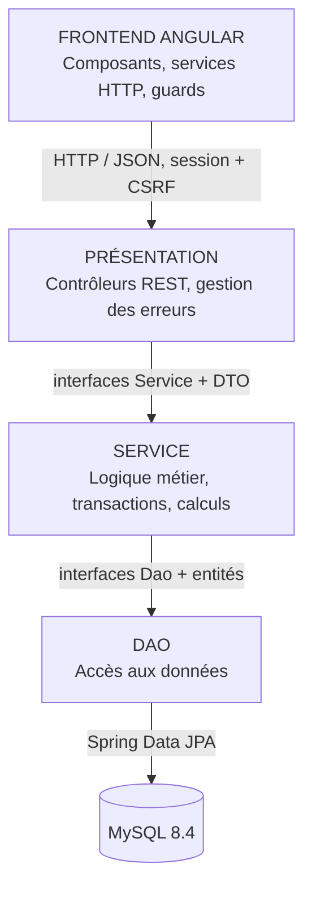

# ClientPulse


**Plateforme B2B de facturation, de suivi des paiements et de prévention de la perte de clients.**

Projet de fin de module Java Enterprise Edition (JEE), ENSAM Casablanca, année 2026-2027.

## 1. Présentation

ClientPulse réunit dans une seule application trois besoins que les PME vivent séparément :

- **Vendre et facturer** : clients, produits, devis, factures, TVA, numérotation continue.
- **Encaisser** : paiements (dont partiels), relances automatiques, balance âgée des créances.
- **Fidéliser** : segmentation RFM et score de risque de départ.

Idée centrale : le comportement de paiement d'un client est l'un des meilleurs signaux de son risque de départ.

L'application est composée d'une **API REST** (Spring Boot) et d'une **interface web** (Angular) qui la consomme.

## 2. Fonctionnalités

| Module | Contenu |
|---|---|
| Sécurité et administration | Authentification par session + jeton CSRF, rôles, utilisateurs, paramètres de scoring et de relance, import CSV |
| Relation client (CRM) | Clients, affectation aux commerciaux, interactions |
| Catalogue et devis | Produits et services, devis, conversion d'un devis accepté en facture, PDF |
| Facturation | Factures, numérotation continue `FAC-AAAA-NNNN`, calcul HT / TVA / TTC, PDF |
| Paiements et relances | Paiements partiels, statut automatique, relances de paiement aux délais paramétrables, balance âgée |
| Analytique | RFM, score de risque avec facteurs explicatifs, clients à relancer |
| Tableau de bord | Trésorerie (CA, encaissé, encours, DSO, recouvrement), rétention, churn, CLV, succès des relances, export CSV |
| Traitements automatiques | Tâches planifiées de nuit : retards, relances, recalcul des scores |

Rôles : Administrateur, Manager commercial, Commercial, Comptable, Analyste.

| Rôle | Accès principal |
|---|---|
| ADMIN | Tout, dont utilisateurs, paramètres, import CSV |
| MANAGER | Clients, affectations, relances, tableau de bord, analytics, factures en lecture et PDF |
| COMMERCIAL | Son portefeuille, ses devis, ses relances |
| COMPTABLE | Factures, paiements, balance âgée, PDF |
| ANALYSTE | Tableau de bord et analytics en consultation |

## 3. Architecture

Le projet comprend un **frontend Angular** et un **backend Spring Boot** structuré en trois couches. Dans le backend, chaque couche ne communique qu'avec sa voisine, **à travers des interfaces**.



| Couche backend | Dépend de | N'a pas le droit d'utiliser |
|---|---|---|
| Présentation | interfaces `service`, `dto` | `dao`, entités JPA, `service.impl` |
| Service | interfaces `dao`, `domain`, `dto` | `presentation`, `dao.impl`, `dao.jpa` |
| DAO | `domain` | `service`, `presentation` |

Ces règles sont vérifiées par un test ArchUnit : le build échoue si elles sont violées.

Principes appliqués :

- aucune logique métier dans les contrôleurs ;
- les entités JPA ne sortent jamais de la couche service : l'API n'expose que des DTO ;
- transactions gérées dans les services ;
- montants en `BigDecimal`, arrondi `HALF_UP` à 2 décimales ;
- validation côté serveur (Bean Validation) avec réponses d'erreur JSON homogènes (`ProblemDetail`) ;
- **authentification par session HTTP** (cookie `JSESSIONID`) avec protection **CSRF** (cookie `XSRF-TOKEN` renvoyé dans l'en-tête `X-XSRF-TOKEN` par Angular) ; mots de passe hachés en BCrypt.

## 4. Structure du dépôt

```text
ClientPulse/
├── src/main/java/ma/ensam/clientpulse/    Backend Spring Boot
│   ├── config/            Sécurité, audit, OpenAPI, planification
│   ├── presentation/controller/   Contrôleurs REST et gestion des erreurs
│   ├── service/           interfaces, impl, mapper, job, scoring
│   ├── dao/               interfaces, impl, jpa
│   ├── domain/            entity, enums
│   ├── dto/               Objets de transfert
│   └── exception/         Exceptions métier
├── src/main/resources/
│   ├── db/migration/      Migrations Flyway V1 à V8
│   ├── db/dev/            V100 : données de démonstration (profil dev)
│   ├── application.properties
│   └── application-dev.properties
├── src/test/              Tests unitaires, d'intégration (Testcontainers), ArchUnit
├── clientpulse-front/     Frontend Angular (core, shared, layout, features)
├── tools/                 generate_demo_data.py, restructure-backend-frontend.sh
├── docs/                  Conception, modèle de données, jeu de démo
├── .github/workflows/     Intégration continue
├── Dockerfile, docker-compose.yml, .env.example
└── pom.xml
```

## 5. Stack technique

| Domaine | Technologies |
|---|---|
| Langage backend | Java 17 |
| Framework backend | Spring Boot 4.1.2, Spring MVC (API REST) |
| Persistance | Spring Data JPA, Hibernate |
| Base de données | MySQL 8.4, migrations Flyway |
| Sécurité | Spring Security (session + CSRF) |
| Validation | Jakarta Bean Validation |
| Documentation de l'API | springdoc-openapi (Swagger UI, profil dev) |
| Documents et fichiers | OpenPDF (PDF), OpenCSV (import / export) |
| Frontend | Angular 21, TypeScript, Chart.js |
| Tests backend | JUnit 5, Mockito, Spring Boot Test, ArchUnit, Testcontainers |
| Tests frontend | Vitest (via `ng test`) |
| Build et CI | Maven, npm, GitHub Actions |
| Conteneurs | Docker, Docker Compose |

## 6. Prérequis

- JDK 17 ou plus récent
- Maven (ou le wrapper `./mvnw` fourni)
- MySQL 8 (ou Docker)
- Node.js 22 (LTS) et npm
- Docker, nécessaire pour les tests d'intégration (Testcontainers) et pour le lancement complet
- Git

## 7. Lancement

### 7.1 Tout en un avec Docker

```bash
cp .env.example .env          # puis adapter les mots de passe
docker compose up --build
```

| Service | Adresse |
|---|---|
| Application | http://localhost:4200 |
| API | http://localhost:8080 |
| Swagger UI (profil dev) | http://localhost:8080/swagger-ui.html |
| phpMyAdmin (optionnel) | `docker compose --profile outils up` puis http://localhost:8081 |

Avec `SPRING_PROFILES_ACTIVE=dev` (valeur par défaut du compose), le jeu de données de démonstration est chargé. Avec `prod`, la base est vide et seuls les comptes d'amorçage sont créés.

### 7.2 En local, sans Docker

1. Créer la base (ou laisser `createDatabaseIfNotExist` le faire) :

```sql
CREATE DATABASE clientpulse CHARACTER SET utf8mb4 COLLATE utf8mb4_unicode_ci;
```

2. Lancer le backend avec le profil dev (données de démo et Swagger UI) :

```bash
export DB_USERNAME=root DB_PASSWORD=<mot-de-passe>      # PowerShell : $env:DB_PASSWORD = "..."
./mvnw spring-boot:run -Dspring-boot.run.profiles=dev
```

3. Lancer le frontend dans un second terminal :

```bash
cd clientpulse-front
npm install
npm start          # ng serve avec proxy.conf.json : /api est relayé vers http://localhost:8080
```

L'interface est sur http://localhost:4200. Variables du backend : `DB_URL`, `DB_USERNAME`, `DB_PASSWORD`, `APP_SEED_*` (comptes d'amorçage), `APP_ENTREPRISE_*` (identité imprimée sur les PDF), `SPRINGDOC_ENABLED`.

### 7.3 Comptes de connexion

| Compte | E-mail | Mot de passe | Origine |
|---|---|---|---|
| Administrateur | `admin@clientpulse.ma` | `Admin@12345` | amorçage (toujours créé) |
| Commercial | `commercial@clientpulse.ma` | `Commercial@12345` | amorçage |
| Manager | `manager@clientpulse.ma` | `Demo@12345` | données de démo (profil dev) |
| Comptable | `comptable@clientpulse.ma` | `Demo@12345` | données de démo |
| Analyste | `analyste@clientpulse.ma` | `Demo@12345` | données de démo |
| Commerciaux 1 à 5 | `commercial1@clientpulse.ma` … `commercial5@…` | `Demo@12345` | données de démo |

Ces mots de passe sont réservés au développement et à la démonstration : en production, les changer par variables d'environnement. **Ne jamais committer de secret.**

### 7.4 Base de données et migrations

Flyway crée le schéma au démarrage ; Hibernate le valide (`ddl-auto=validate`) sans jamais le modifier. Détail des tables : [`docs/modele-donnees.md`](docs/modele-donnees.md).

| Migration | Contenu |
|---|---|
| V1 | Schéma initial |
| V2 | Rôles |
| V4 | Paramètres de scoring, scores, relances, interactions |
| V5 | Compléments du scoring |
| V6 | Taux de TVA et catalogue produits |
| V7 | Journal des imports CSV |
| V8 | Délais paramétrables des relances de paiement |
| V100 | Données de démonstration (profil dev uniquement) |

**Règle : les migrations métier restent numérotées sous V100.** Une migration numérotée au-dessus d'une migration déjà appliquée serait refusée par Flyway.

### 7.5 Jeu de données de démonstration

`tools/generate_demo_data.py` régénère `V100__demo_data.sql` (90 clients, 391 devis, 822 factures, 810 paiements, relances). Le contenu et le scénario de démonstration sont décrits dans [`docs/jeu-de-donnees-demo.md`](docs/jeu-de-donnees-demo.md). Les scores de risque et segments RFM sont calculés par le moteur : lancer « Recalculer » dans l'écran Analytics, ou attendre le traitement de nuit.

## 8. API REST

Documentation interactive : `/swagger-ui.html` (profil dev). Principales ressources :

| Ressource | Endpoint | Description |
|---|---|---|
| Authentification | `/api/auth` | Connexion, déconnexion, utilisateur courant |
| Utilisateurs | `/api/utilisateurs` | Comptes et rôles |
| Clients | `/api/clients` | Gestion et affectation des clients |
| Produits, TVA | `/api/produits`, `/api/taux-tva` | Catalogue et taux |
| Devis | `/api/devis` | Devis, conversion en facture, `/api/devis/{id}/pdf` |
| Factures | `/api/factures` | Émission, paiements, balance âgée, `/api/factures/{id}/pdf` |
| Relances | `/api/relances` | Relances de paiement et commerciales |
| Analytique | `/api/analytics` | RFM, scores, clients à relancer |
| Paramètres | `/api/parametres` | Poids, seuils et délais de relance |
| Tableau de bord | `/api/dashboard`, `/api/dashboard/export` | Indicateurs et export CSV |
| Import CSV | `/api/import/clients`, `/journal`, `/modele-clients` | Import de clients (ADMIN) |

Conventions :

- échanges en JSON ; les requêtes d'écriture portent l'en-tête `X-XSRF-TOKEN` ;
- listes paginées : `?page=0&size=10&sort=champ,asc` ;
- erreurs au format `ProblemDetail` avec les statuts `400`, `401`, `403`, `404`, `409`, `413`, `422`, `500`.

## 9. Règles métier clés

- **Numérotation continue** : `FAC-AAAA-NNNN`, compteur remis à 1 chaque année, attribué à l'émission dans la même transaction, verrou pessimiste sur `sequence_numerotation`.
- **Calculs** : `BigDecimal`, HT ligne = quantité × prix × (1 − remise %), TVA par taux, taux copié sur la ligne à l'émission.
- **Relances de paiement** : une par niveau et par facture, aux délais J-3, J+3, J+15, J+30, J+45 par défaut, modifiables dans Paramètres (V8).
- **Tableau de bord** : un client est « actif » s'il a une facture émise dans les 12 derniers mois ; rétention = (clients fin − nouveaux) ÷ clients début ; CLV = marge moyenne par facture × factures par client et par an × durée de vie (1 ÷ churn, plafonnée à 10 ans) ; succès d'une relance = paiement ou nouvelle facture dans les 30 jours.

## 10. Tests

```bash
./mvnw clean verify        # unitaires, ArchUnit, intégration (Docker démarré)
cd clientpulse-front && npm test -- --watch=false
```

La CI (`.github/workflows/ci.yml`) exécute `mvn verify`, `ng build` et `ng test` à chaque push et pull request.

## 11. Workflow Git

- `main` : version stable. `develop` : intégration. `feature/<sujet>` : une branche par fonctionnalité. `fix/<sujet>` : corrections.
- Commits conventionnels : `feat:`, `fix:`, `docs:`, `test:`, `refactor:`.
- Toute modification passe par une pull request relue par un autre membre.

## 12. Équipe

| Membre | Domaine principal |
|---|---|
| Personne 1 | Facturation : devis, numérotation, TVA, paiements, relances de paiement, balance âgée |
| Personne 2 | Socle CRM, sécurité, scoring, RFM, relances commerciales |
| Personne 3 | Socle technique (migrations, CI, Docker), import CSV, PDF, tableau de bord, paramètres |

## 13. Feuille de route

- [x] Choix du sujet et création du dépôt
- [x] Conception UML et modèle de données (Livrable 2)
- [x] Backend et frontend initialisés, sécurité et rôles
- [x] Clients, produits, TVA, devis, factures, paiements, relances, balance âgée
- [x] RFM, score de risque, tableau de bord, import CSV, PDF
- [ ] Tests de bout en bout depuis un clone neuf, présentation et démonstration (dernière semaine de novembre 2026)

## 14. Contexte académique

**Établissement :** ENSAM Casablanca · **Module :** Java Enterprise Edition (JEE) · **Année :** 2026-2027

---

*ClientPulse : relier la performance financière à la fidélité des clients.*
