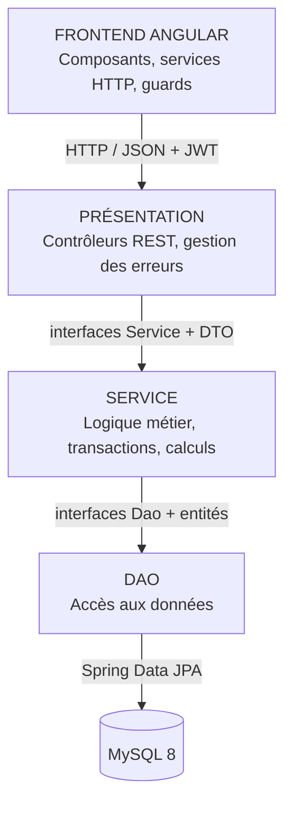

# ClientPulse


**Plateforme B2B de facturation, de suivi des paiements et de prévention de la perte de clients.**

Projet de fin de module Java Enterprise Edition (JEE), ENSAM Casablanca, année 2026-2027.

## 1. Présentation

ClientPulse réunit dans une seule application trois besoins que les PME vivent séparément :

- **Vendre et facturer** : clients, produits, devis, factures, TVA, numérotation continue.
- **Encaisser** : paiements (dont partiels), relances automatiques, balance âgée des créances.
- **Fidéliser** : segmentation RFM et score de risque de départ.

Idée centrale : le comportement de paiement d'un client est l'un des meilleurs signaux de son risque de départ.

L'application est composée d'une **API REST** (Spring Boot) et d'une **interface web** (Angular) qui la consomme.

## 2. Fonctionnalités

| Module | Contenu |
|---|---|
| Sécurité et administration | Authentification JWT, rôles, utilisateurs, taux de TVA, paramètres de scoring, import CSV |
| Relation client (CRM) | Clients, affectation aux commerciaux, interactions, contrats (optionnel) |
| Catalogue et devis | Produits et services, devis, conversion d'un devis accepté en facture |
| Facturation | Factures et avoirs, numérotation continue `FAC-AAAA-NNNN`, calcul HT / TVA / TTC |
| Paiements et relances | Paiements partiels, statut automatique, relances de paiement, balance âgée |
| Analytique | RFM, score de risque avec facteurs explicatifs, clients à relancer, tableau de bord |
| Traitements automatiques | Tâche planifiée nocturne : retards, relances, recalcul des scores |

Rôles : Administrateur, Manager commercial, Commercial, Comptable, Analyste.

## 3. Architecture

Le projet comprend deux applications : un **frontend Angular** et un **backend Spring Boot** structuré en trois couches. Dans le backend, chaque couche ne communique qu'avec sa voisine, **à travers des interfaces**, pour éviter le couplage fort entre classes.



| Couche backend | Dépend de | N'a pas le droit d'utiliser |
|---|---|---|
| Présentation | interfaces `service`, `dto` | `dao`, entités JPA, `service.impl` |
| Service | interfaces `dao`, `domain`, `dto` | `presentation`, `dao.impl`, `dao.jpa` |
| DAO | `domain` | `service`, `presentation` |

Ces règles sont vérifiées automatiquement par un test ArchUnit : le build échoue si elles sont violées.

Principes appliqués :

- aucune logique métier dans les contrôleurs ;
- les entités JPA ne sortent jamais de la couche service : l'API n'expose que des DTO ;
- transactions gérées dans les services ;
- montants en `BigDecimal` ;
- validation côté serveur (Bean Validation) avec réponses d'erreur JSON homogènes ;
- API sans état : authentification par jeton JWT.

## 4. Structure du projet

```text
ClientPulse/
├── backend/
│   ├── src/main/java/ma/ensam/clientpulse/
│   │   ├── config/            Sécurité, JWT, CORS, planification
│   │   ├── presentation/
│   │   │   ├── controller/    Contrôleurs REST
│   │   │   └── advice/        Gestion centralisée des erreurs (JSON)
│   │   ├── service/
│   │   │   ├── interfaces/    Contrats métier
│   │   │   ├── impl/          Implémentations
│   │   │   ├── mapper/        Conversion entité / DTO
│   │   │   └── job/           Tâches planifiées
│   │   ├── dao/
│   │   │   ├── interfaces/    Contrats d'accès aux données
│   │   │   ├── impl/          Implémentations
│   │   │   └── jpa/           Repositories Spring Data
│   │   ├── domain/
│   │   │   ├── entity/        Entités JPA
│   │   │   └── enums/         Énumérations métier
│   │   ├── dto/               Objets de transfert et validation
│   │   ├── exception/         Exceptions métier
│   │   └── ClientPulseApplication.java
│   ├── src/main/resources/
│   │   ├── db/migration/      Migrations Flyway
│   │   └── application.properties
│   ├── src/test/              Tests unitaires, d'intégration, ArchUnit
│   └── pom.xml
│
├── frontend/
│   ├── src/app/
│   │   ├── core/              Authentification, intercepteurs HTTP, guards
│   │   ├── shared/            Composants et modèles partagés
│   │   └── features/          clients, devis, factures, paiements,
│   │                          relances, dashboard
│   ├── src/environments/      URL de l'API par environnement
│   ├── angular.json
│   └── package.json
│
├── docs/                      Conception, UML, maquettes
├── .github/workflows/         Intégration continue
├── .gitignore
└── README.md
```

## 5. Stack technique

| Domaine | Technologies |
|---|---|
| Langage backend | Java 17 |
| Framework backend | Spring Boot 3, Spring MVC (API REST) |
| Persistance | Spring Data JPA, Hibernate |
| Base de données | MySQL 8, migrations Flyway |
| Sécurité | Spring Security, JWT |
| Validation | Jakarta Bean Validation |
| Documentation de l'API | springdoc-openapi (Swagger UI) |
| Documents et fichiers | OpenPDF (PDF), OpenCSV (import / export) |
| Frontend | Angular, TypeScript |
| Interface | Bootstrap 5, Chart.js |
| Tests backend | JUnit 5, Mockito, Spring Boot Test, ArchUnit, Testcontainers |
| Tests frontend | Jasmine / Karma (outils fournis par Angular) |
| Build et CI | Maven, npm, GitHub Actions |
| Conteneurs | Docker, Docker Compose (prévu) |

## 6. Prérequis

- JDK 17 ou plus récent
- Maven (ou le wrapper `./mvnw` fourni)
- MySQL 8
- Node.js (version LTS) et npm
- Angular CLI : `npm install -g @angular/cli`
- Docker, nécessaire pour les tests d'intégration (Testcontainers)
- Git

## 7. Installation et lancement

### 7.1 Cloner le dépôt

```bash
git clone https://github.com/<UTILISATEUR>/ClientPulse.git
cd ClientPulse
```

### 7.2 Créer la base de données

```sql
CREATE DATABASE clientpulse
CHARACTER SET utf8mb4
COLLATE utf8mb4_unicode_ci;
```

### 7.3 Configurer le backend

Dans `backend/src/main/resources/application.properties` :

```properties
spring.datasource.url=jdbc:mysql://localhost:3306/clientpulse?useSSL=false&serverTimezone=UTC&allowPublicKeyRetrieval=true
spring.datasource.username=${DB_USERNAME:clientpulse}
spring.datasource.password=${DB_PASSWORD}
spring.jpa.hibernate.ddl-auto=none
spring.flyway.enabled=true
app.jwt.secret=${JWT_SECRET}
```

Définir les variables d'environnement `DB_USERNAME`, `DB_PASSWORD` et `JWT_SECRET`. **Ne jamais committer de mot de passe ni de secret.**

### 7.4 Lancer le backend

```bash
cd backend
./mvnw spring-boot:run
```

L'API est disponible sur http://localhost:8080. Une fois springdoc ajouté, la documentation interactive sera sur http://localhost:8080/swagger-ui.html.

### 7.5 Lancer le frontend

Dans un second terminal :

```bash
cd frontend
npm install
ng serve
```

L'interface est disponible sur http://localhost:4200. Elle appelle l'API via l'URL définie dans `src/environments/`.

## 8. API REST

Les ressources prévues (les routes peuvent évoluer pendant le développement) :

| Ressource | Endpoint | Description |
|---|---|---|
| Authentification | `/api/auth` | Connexion, jeton JWT |
| Utilisateurs | `/api/utilisateurs` | Comptes et rôles |
| Clients | `/api/clients` | Gestion des clients |
| Produits | `/api/produits` | Catalogue |
| Taux de TVA | `/api/taux-tva` | Paramétrage de la TVA |
| Devis | `/api/devis` | Devis et conversion en facture |
| Factures | `/api/factures` | Factures, émission, avoirs |
| Paiements | `/api/paiements` | Paiements, dont partiels |
| Relances | `/api/relances` | Relances de paiement et commerciales |
| Analytique | `/api/analytics` | RFM, scores, clients à relancer |
| Tableau de bord | `/api/dashboard` | Indicateurs |

Conventions :

- échanges en JSON, authentification par en-tête `Authorization: Bearer <jeton>` ;
- listes paginées : `?page=0&size=10&sort=champ,asc` ;
- erreurs au format JSON (code, message, détails par champ) avec les statuts HTTP `400`, `401`, `403`, `404`, `409`.

## 9. Tests

Backend :

```bash
cd backend
./mvnw clean verify
```

Lance les tests unitaires, les règles d'architecture (ArchUnit) et les tests d'intégration. Docker doit être démarré.

Frontend :

```bash
cd frontend
ng test
```

## 10. Docker (prévu)

```bash
docker compose up --build
```

Le `docker-compose.yml` (MySQL, backend, frontend) sera ajouté au Sprint 4.

## 11. Workflow Git

- `main` : version stable. `develop` : intégration. `feature/<sujet>` : une branche par fonctionnalité. `fix/<sujet>` : corrections.
- Commits conventionnels : `feat:`, `fix:`, `docs:`, `test:`, `refactor:`.
- Toute modification passe par une pull request relue par un autre membre.

```bash
git checkout develop
git checkout -b feature/gestion-clients
git commit -m "feat: ajout de l'API de gestion des clients"
```


## 13. Feuille de route

- [x] Choix du sujet et création du dépôt
- [ ] Conception UML et modèle de données (Livrable 2, 8 novembre 2026)
- [ ] Initialisation du backend et du frontend, sécurité JWT et rôles
- [ ] Clients, produits, TVA, devis (API + interface)
- [ ] Factures, numérotation continue, paiements, relances, balance âgée
- [ ] RFM, score de risque, tableau de bord
- [ ] Tests, Docker, CI
- [ ] Documentation, présentation et démonstration (dernière semaine de novembre 2026)

## 14. Contexte académique

**Établissement :** ENSAM Casablanca · **Module :** Java Enterprise Edition (JEE) · **Année :** 2026-2027

---

*ClientPulse : relier la performance financière à la fidélité des clients.*
