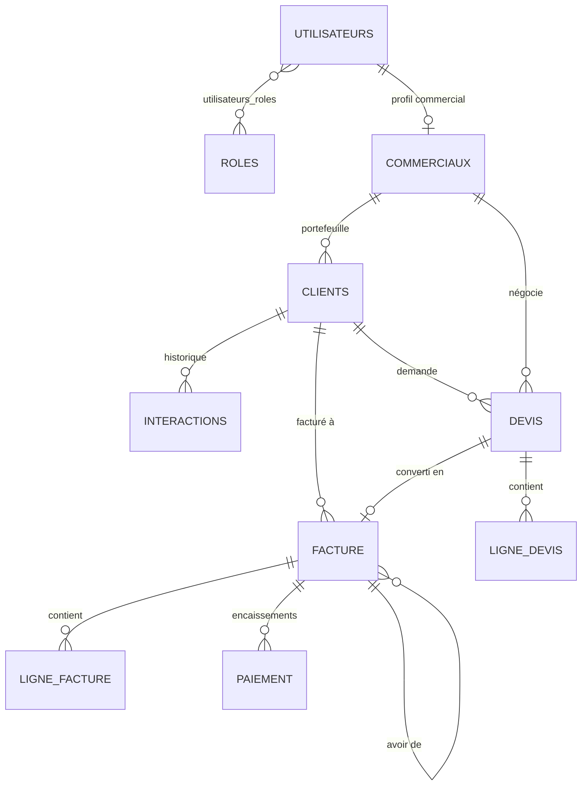

# Modèle de données ClientPulse

Schéma physique de la base MySQL 8, versionné par Flyway dans
`src/main/resources/db/migration/`.

- `V1__init.sql` : création des 12 tables, contraintes et index ;
- `V2__roles.sql` : insertion des 5 rôles applicatifs.

Hibernate ne crée plus le schéma : `spring.jpa.hibernate.ddl-auto=validate`
vérifie au démarrage que les entités correspondent aux tables. Un écart fait
échouer l'application avec un message explicite.

## 1. Diagramme des relations



## 2. Tables

| Table | Rôle | Clés et contraintes principales |
|---|---|---|
| `roles` | Rôles applicatifs (`RoleNom`) | `uk_roles_nom` sur `nom` |
| `utilisateurs` | Comptes de connexion | `uk_utilisateurs_email` sur `email`, `actif BIT(1)` |
| `utilisateurs_roles` | Jointure utilisateur / rôle | PK (`utilisateur_id`, `role_id`), FK vers les deux tables |
| `commerciaux` | Profil commercial d'un utilisateur | `uk_commerciaux_utilisateur` (relation 1–1), `objectif_mensuel DECIMAL(12,2)` |
| `clients` | Entreprises et particuliers | `uk_clients_code`, FK `commercial_id` (nullable) |
| `interactions` | Appels, e-mails, réunions, réclamations | FK `client_id` obligatoire, `date DATETIME(6)` |
| `sequence_numerotation` | Compteurs `DEVIS` / `FACTURE` / `AVOIR` | `uk_sequence_numerotation_type_annee` sur (`type`, `annee`) |
| `devis` | Proposition commerciale | `uk_devis_numero`, FK `client_id`, FK `commercial_id` |
| `ligne_devis` | Lignes d'un devis | FK `devis_id`, suppression en cascade applicative |
| `facture` | Facture ou avoir | `uk_facture_numero`, `uk_facture_devis` (1 facture max par devis), FK `client_id`, `devis_id`, `facture_origine_id` |
| `ligne_facture` | Lignes d'une facture | FK `facture_id`, `montant_ht` / `montant_tva` figés |
| `paiement` | Encaissement partiel ou total | FK `facture_id`, `montant DECIMAL(15,2)` |

## 3. Conventions

- **Nommage** : tables et colonnes en `snake_case`, noms de contraintes explicites
  (`uk_*`, `fk_*`, `idx_*`) au lieu des identifiants générés par Hibernate.
- **Montants** : `DECIMAL(15,2)`. Taux et remises : `DECIMAL(5,2)` (pourcentage).
- **Dates** : `DATE` pour les dates métier (émission, échéance, paiement),
  `DATETIME(6)` pour les horodatages techniques et les interactions.
- **Énumérations** : colonnes `ENUM` natives MySQL, alignées sur les `enum` Java
  (`RoleNom`, `StatutFacture`, …). Ajouter une valeur impose une migration
  `ALTER TABLE ... MODIFY COLUMN ... ENUM(...)` : c'est volontaire, cela empêche
  une valeur inconnue d'arriver en base.
- **Audit** : `date_creation`, `date_modification`, `cree_par`, `modifie_par`
  sont fournis par `EntiteTracable` + `AuditConfig`. Ces colonnes n'existent que
  sur les entités qui étendent `EntiteTracable` (`devis`, `facture`, `paiement`).
  `clients`, `interactions`, `utilisateurs` et `commerciaux` n'en ont pas.
- **Reste à payer** : jamais stocké. Il se calcule (`total_ttc - somme(paiements)`),
  donc il ne peut pas être incohérent.

## 4. Règles de migration

1. Une migration **déjà appliquée ne se modifie jamais** : on ajoute un fichier
   `V<n>__sujet.sql`.
2. Toute modification du modèle doit être répercutée **dans le même commit** sur
   l'entité JPA et sur la migration, sinon `ddl-auto=validate` casse le démarrage.
3. `V2__roles.sql` utilise `ON DUPLICATE KEY UPDATE` pour rester rejouable sur une
   base créée auparavant par `ddl-auto=update`.
4. `spring.flyway.baseline-on-migrate=true` : une base existante non vide est
   marquée en version 1 (V1 non rejouée) puis V2 est appliquée.

## 5. Base locale

```sql
CREATE DATABASE clientpulse
  CHARACTER SET utf8mb4
  COLLATE utf8mb4_unicode_ci;
```

```properties
spring.datasource.url=jdbc:mysql://localhost:3306/clientpulse?useSSL=false&serverTimezone=UTC&allowPublicKeyRetrieval=true
spring.datasource.username=${DB_USERNAME:root}
spring.datasource.password=${DB_PASSWORD:}
spring.flyway.enabled=true
spring.jpa.hibernate.ddl-auto=validate
```

Les comptes de démonstration sont créés par `DataInitializer` après les
migrations : `admin@clientpulse.ma` / `Admin@12345` et
`commercial@clientpulse.ma` / `Commercial@12345` (modifiables par variables
d'environnement, voir `application.properties`).

Pour repartir d'un schéma propre en développement :

```sql
DROP DATABASE clientpulse;
CREATE DATABASE clientpulse CHARACTER SET utf8mb4 COLLATE utf8mb4_unicode_ci;
```

Flyway rejoue alors V1 puis V2 au démarrage suivant.

## 6. Vérifier le socle de persistance

Le script [`docs/sql/verifications-p3.sql`](sql/verifications-p3.sql) contient les
requêtes de contrôle : migrations appliquées, présence des 12 tables, contraintes,
index, colonnes de `clients`, rôles, comptes de démonstration. Il s'exécute tel
quel dans phpMyAdmin (onglet SQL) ou en ligne de commande :

```bash
mysql -u root clientpulse < docs/sql/verifications-p3.sql
```

